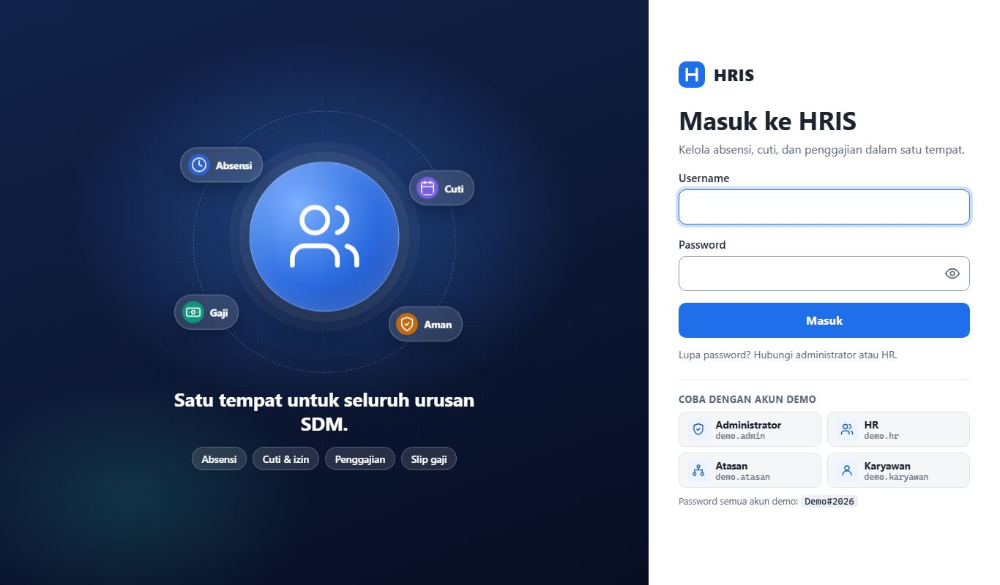
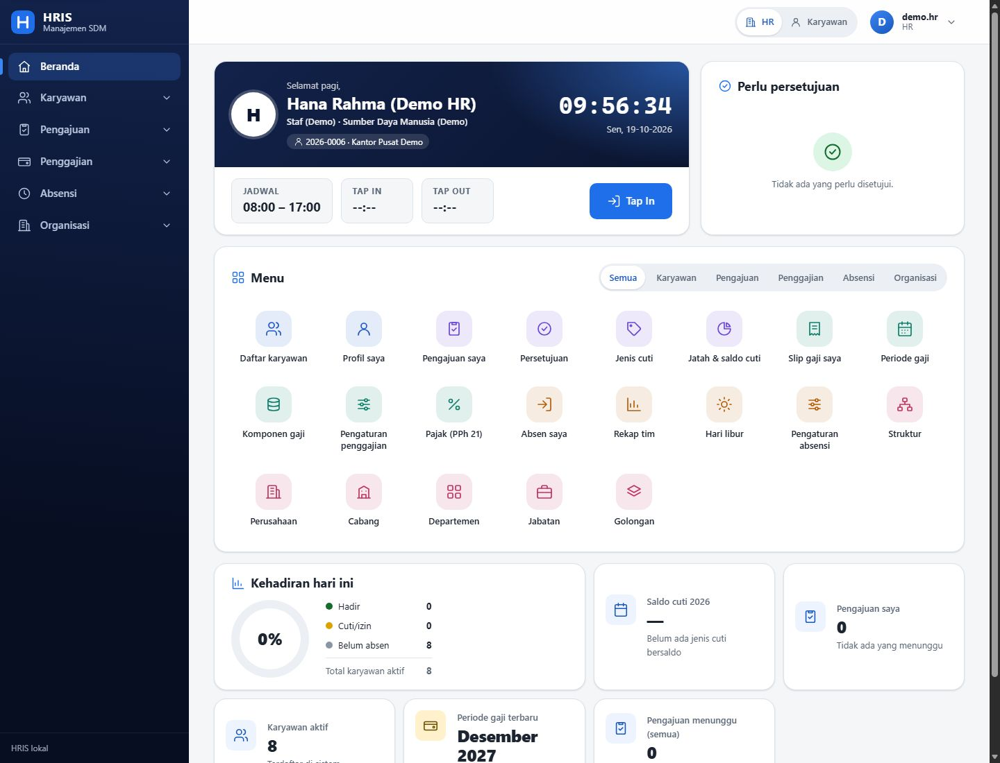
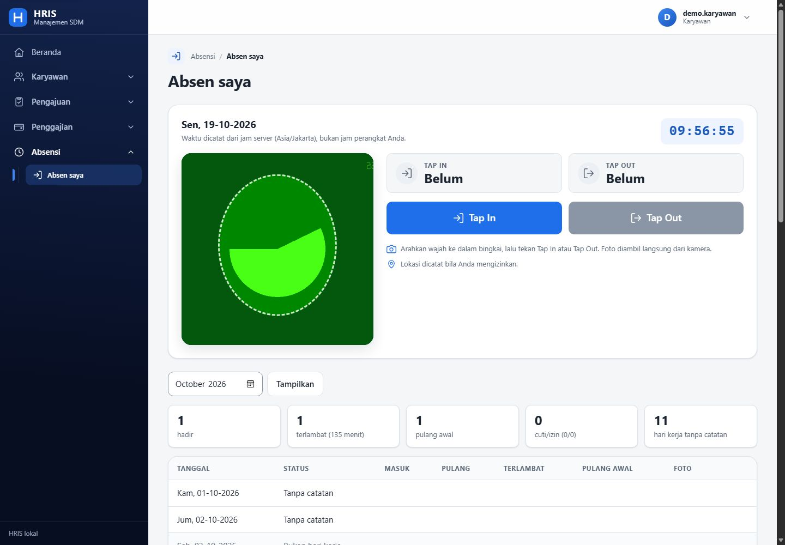
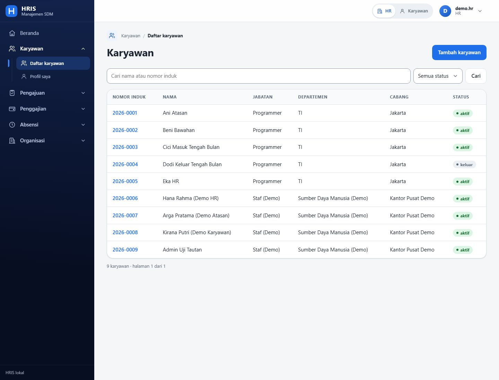
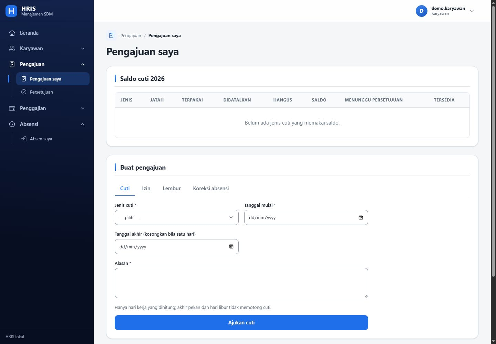
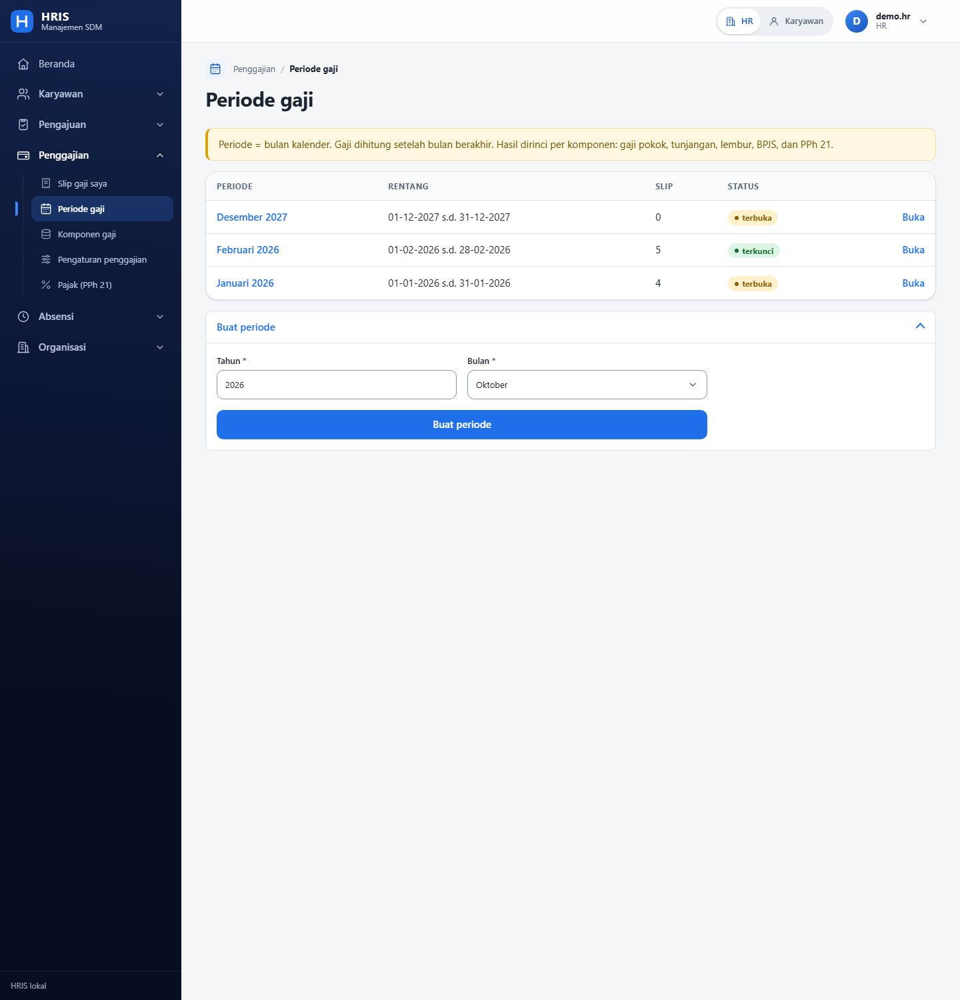
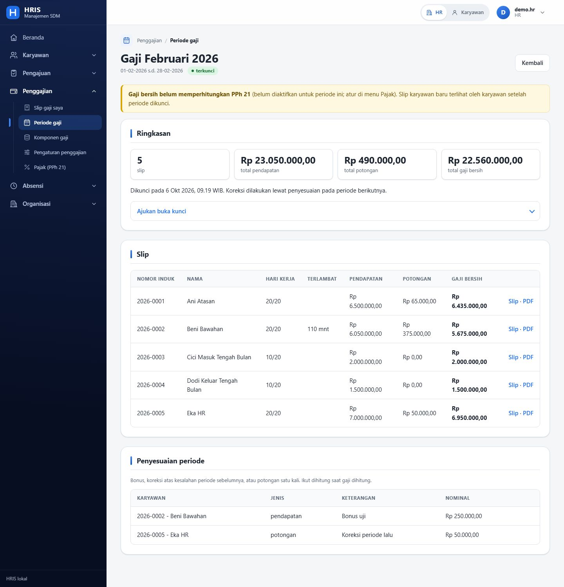
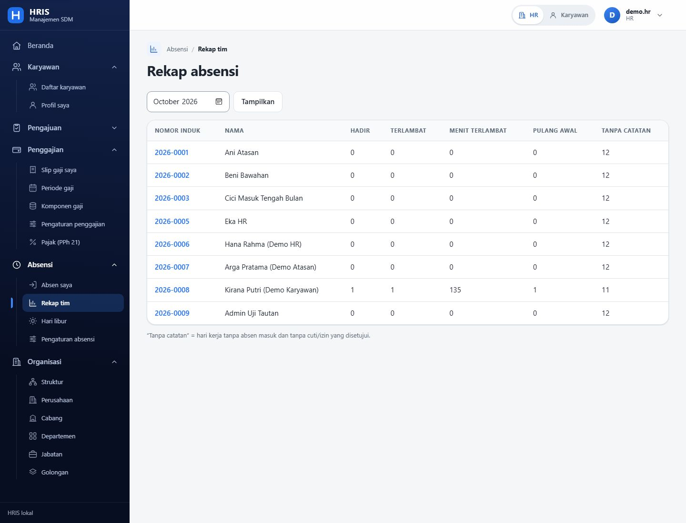
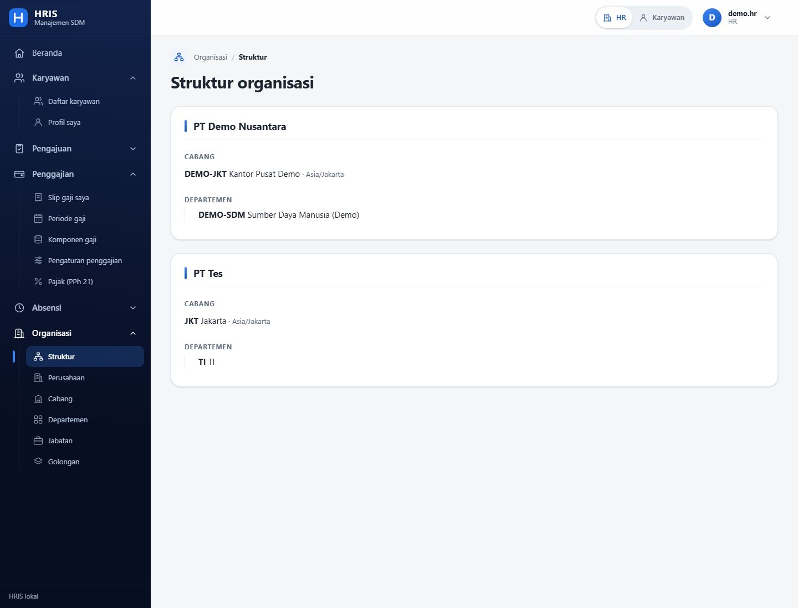
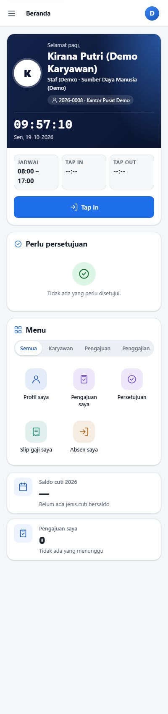

# HRIS Nusantara

Sistem HRIS (Human Resource Information System) berbahasa Indonesia yang ringan dan berjalan lokal: data karyawan, absensi **Tap In / Tap Out berkamera**, cuti & izin, lembur, persetujuan bertingkat, hingga **penggajian lengkap** (BPJS, PPh 21 TER, slip gaji PDF).

Dibuat tanpa tahap build, tanpa ORM, dan tanpa library native: cukup Node.js dan PostgreSQL.



## Daftar isi

- [Fitur](#fitur)
- [Tampilan](#tampilan)
- [Teknologi](#teknologi)
- [Memulai](#memulai)
- [Akun demo](#akun-demo)
- [Peran dan hak akses](#peran-dan-hak-akses)
- [Aturan keselamatan data](#aturan-keselamatan-data)
- [Struktur folder](#struktur-folder)
- [Pengujian](#pengujian)
- [Batasan yang perlu diketahui](#batasan-yang-perlu-diketahui)

## Fitur

| Modul | Isi |
|---|---|
| **Beranda** | Dasbor per peran: kartu profil + Tap In/Out, daftar "perlu persetujuan", menu ikon bersaring per kelompok, kehadiran hari ini (admin/HR). |
| **Karyawan** | Data pribadi, penempatan (cabang, departemen, jabatan, golongan, atasan), gaji dan kontrak sebagai **riwayat bertanggal berlaku**, keluarga, pendidikan, dokumen, BPJS, status pajak, akun login, dan proses keluar (nonaktif, login dicabut, riwayat tetap). |
| **Organisasi** | Perusahaan, cabang (dengan zona waktu), departemen, jabatan, golongan, struktur organisasi berbentuk pohon. |
| **Absensi** | Tap In / Tap Out dengan kamera langsung dan bingkai wajah, lokasi (bila diizinkan), jam server, jadwal kerja bertanggal berlaku, hari libur, rekap tim, koreksi lewat pengajuan. |
| **Pengajuan & persetujuan** | Cuti, izin, lembur, dan koreksi absensi. Alur persetujuan dapat diatur (atasan lalu HR, atau HR saja). Tiap langkah tercatat; pengaju tidak dapat menyetujui pengajuannya sendiri. |
| **Cuti** | Jenis cuti, jatah per karyawan, saldo yang hanya berubah lewat mutasi (tidak bisa ditimpa), penolakan otomatis bila tumpang tindih atau melebihi saldo, hangus akhir tahun oleh worker. |
| **Lembur** | Pengajuan lembur dan aturan pengali bertanggal berlaku (preset Kepmenaker 102/2004), upah lembur masuk slip. |
| **Penggajian** | Periode gaji bulanan, komponen gaji, BPJS, **PPh 21 metode TER** dengan penyesuaian masa pajak terakhir, penyesuaian periode, kunci periode, dan permintaan buka kunci yang harus disetujui admin lain. |
| **Slip gaji** | Karyawan hanya melihat slip miliknya dari periode yang sudah dikunci; PDF dibuat saat diminta (tidak disimpan). |
| **Mode Karyawan** | Admin/HR/atasan yang punya data karyawan dapat berpindah ke tampilan layanan mandiri lewat tombol di header. |
| **Jejak audit** | Perubahan data karyawan, gaji, absensi, saldo cuti, hak akses, dan pengaturan dicatat. |

## Tampilan

### Beranda (HR)


### Tap In / Tap Out dengan kamera
Kamera menyala langsung di halaman; wajah diarahkan ke bingkai lalu tekan **Tap In** atau **Tap Out**. Foto dikecilkan di browser (maks. 400 px) sebelum dikirim, dan waktu dicatat dari jam server. *(Tangkapan layar ini memakai kamera uji bawaan browser, jadi gambarnya berupa pola hijau.)*



### Data karyawan


### Pengajuan cuti, izin, lembur, dan koreksi


### Periode gaji


### Rincian periode gaji dan slip


### Rekap absensi tim


### Struktur organisasi


### Tampilan ponsel
Sidebar menjadi laci, kartu menumpuk satu kolom, dan semua tombol berukuran sentuh minimal 44 px.



> Semua tangkapan layar memakai **data demo fiktif**.

## Teknologi

- **Server:** Node.js 20+, Express 4
- **Tampilan:** EJS (render di server), HTMX dan Alpine.js (file statis di `public/js`, tanpa build), CSS tulisan tangan dengan token desain tiga lapis (primitif, semantik, komponen)
- **Basis data:** PostgreSQL 16+ lewat `pg` dengan SQL murni, migrasi SQL bernomor
- **Keamanan:** JWT dalam cookie bertanda tangan, `bcryptjs`, `helmet` (CSP), token CSRF
- **Lain-lain:** `node-cron` (worker), `pdfmake` (slip PDF), `nodemailer`, `dayjs`, `uuid`

Dependency dibatasi: express, ejs, pg, bcryptjs, jsonwebtoken, cookie-parser, helmet, dotenv, dayjs, node-cron, nodemailer, pdfmake, chart.js, uuid. Tidak ada devDependencies, tahap build, ORM, atau library native.

## Memulai

Prasyarat: **Node.js 20+** dan **PostgreSQL 16+**. Contoh perintah memakai PowerShell (Windows).

```powershell
# 1. Pasang dependency
npm install --omit=dev

# 2. Buat database kosong, mis. hris
#    (lewat psql atau pgAdmin)

# 3. Salin konfigurasi lalu isi nilainya
Copy-Item .env.example .env
#    Isi DATABASE_URL, JWT_SECRET, dan COOKIE_SECRET dengan nilai acak yang panjang.
#    Jangan pernah meng-commit file .env.

# 4. Jalankan migrasi skema
npm run migrate

# 5. Buat akun administrator pertama
node scripts/seed.js admin
#    Tanpa argumen kedua, password acak ditampilkan sekali di terminal.

# 6. Jalankan aplikasi
npm start            # server, http://localhost:3000
npm run worker       # (terminal lain) tugas terjadwal
```

Mode pengembangan dengan muat ulang otomatis: `npm run dev`.

Variabel di `.env`:

| Variabel | Fungsi |
|---|---|
| `PORT` | Port server. |
| `NODE_ENV` | `development` atau `production`. |
| `DATABASE_URL` | Alamat koneksi PostgreSQL. |
| `JWT_SECRET`, `COOKIE_SECRET` | Rahasia penanda tangan sesi; wajib acak dan panjang. |
| `COOKIE_SECURE` | `true` bila dilayani lewat HTTPS. |
| `DEMO_AKUN` | `true` menampilkan panel akun demo di halaman masuk. **Jangan dinyalakan di produksi** (ditolak otomatis bila `NODE_ENV=production`). |

> Kamera langsung untuk Tap In/Out hanya tersedia di `localhost` atau lewat **HTTPS**. Di alamat HTTP biasa, aplikasi memakai kamera bawaan perangkat sebagai cadangan.

### Tarif dan angka pajak

Tarif BPJS, tabel TER PPh 21, PTKP, UMK, dan pengali lembur **tidak diisi bawaan** dan tidak dikarang. Semuanya disimpan di tabel pengaturan bertanggal berlaku dan diisi oleh pemilik lewat menu **Pengaturan penggajian** dan **Pajak (PPh 21)** (mendukung impor CSV). Pengali lembur menyediakan preset Kepmenaker 102/2004.

## Akun demo

Untuk mencoba cepat di lingkungan lokal:

```powershell
# di .env: DEMO_AKUN=true
node scripts/seed-demo.js
```

Panel akun demo tampil di halaman masuk. Password semua akun demo: `Demo#2026`.

| Peran | Username |
|---|---|
| Administrator | `demo.admin` |
| HR | `demo.hr` |
| Atasan | `demo.atasan` |
| Karyawan | `demo.karyawan` |

Menonaktifkan seluruh akun demo: `node scripts/seed-demo.js --nonaktifkan`.

Akun administrator murni tidak punya data karyawan, sehingga Tap In/Out dan Mode Karyawan belum tersedia. Administrator dapat menautkan akunnya ke satu data karyawan lewat tombol **Karyawan** di header (halaman `/akun/tautan`).

## Peran dan hak akses

| Peran | Cakupan |
|---|---|
| **Karyawan** | Hanya data dirinya sendiri: profil, absen, pengajuan, slip gaji. |
| **Atasan** | Diri sendiri dan bawahannya (rekap tim, persetujuan). |
| **HR** | Seluruh karyawan sesuai cakupan: data, absensi, cuti, penggajian, pengaturan. |
| **Administrator** | Semua fitur HR, pengelolaan akun login, alur persetujuan, dan persetujuan buka kunci periode gaji. |

Hak akses diperiksa berlapis: di middleware **dan** di service. Mode Karyawan hanya mengubah tampilan, bukan hak akses.

## Aturan keselamatan data

- NIK, NPWP, rekening, dan gaji hanya terlihat oleh peran berhak, disamarkan di daftar, dan tidak pernah masuk log maupun jejak audit.
- Uang memakai `NUMERIC(15,2)` dan dihitung dengan bilangan bulat (sen) atau di SQL, tidak pernah float.
- Semua tabel punya `id`, `created_at`, `updated_at`, `deleted_at` (soft delete).
- Operasi multi-tabel selalu dalam satu transaksi.
- Catatan absensi mentah dan mutasi saldo cuti tidak dapat diubah (dijaga trigger database); koreksi lewat pengajuan yang disetujui.
- Periode gaji yang dikunci tidak dapat diedit; koreksi lewat penyesuaian periode berikutnya atau buka kunci dengan persetujuan admin lain dan jejak audit.
- Skema hanya berubah lewat migrasi baru; migrasi lama tidak diedit (checksum diperiksa).
- Foto absensi dikecilkan di browser, disimpan di `uploads/` (di luar git), dan database hanya menyimpan path. Foto dihapus otomatis oleh worker setelah masa simpan (bawaan 3 bulan), sedangkan catatannya tetap ada. Dokumen hanya dapat diakses lewat route ber-hak-akses.
- Slip dan surat PDF tidak disimpan; dibuat saat diminta.

## Struktur folder

```
migrations/     migrasi SQL bernomor (001 s.d. 009)
scripts/        migrate.js, seed.js, seed-demo.js
src/
  app.js        perakitan Express, middleware, helmet, CSRF
  server.js     titik masuk server
  config/       env, db (helper transaksi), menu, ikon
  middleware/   autentikasi, CSRF, penanganan galat
  modules/      satu folder per domain
    pengguna/ organisasi/ karyawan/ absensi/ persetujuan/
    cuti/ lembur/ penggajian/ beranda/
      routes.js, controllers/, services/   (SQL hanya di services/)
  views/        template EJS
public/         css, js statis (htmx, alpine, absen.js, dll.)
worker/         tugas terjadwal (node-cron)
tests/          pengujian node:test
docs/gambar/    tangkapan layar untuk README
```

Pembagian tanggung jawab: controller tidak menulis SQL; SQL hanya ada di `services/`. Transaksi memakai helper `transaksi()` di `src/config/db.js`.

### Tugas terjadwal (worker)

| Jadwal | Tugas |
|---|---|
| 01:00 | Menghanguskan saldo cuti yang melewati masa berlaku. |
| 02:00 | Menghapus foto absensi yang melewati masa simpan. |

Log dihapus otomatis setelah 14 hari agar tidak tumbuh tanpa batas.

## Pengujian

```powershell
npm test
```

Memakai `node:test` dan `node:assert` bawaan Node (tanpa library tambahan). Cakupannya antara lain mesin hitung uang, PPh 21 TER, lembur, BPJS, alur persetujuan, hak akses, CSV, berkas/foto, halaman masuk, menu, dan kontras warna (WCAG) yang dihitung langsung dari token desain.

## Batasan yang perlu diketahui

- **Pengenalan wajah belum ada.** Tap In/Out mengambil foto selfie langsung dari kamera sebagai bukti yang dapat ditinjau HR. Bila browser mendukung `FaceDetector`, foto tanpa wajah ditolak; pencocokan identitas wajah tidak dilakukan karena butuh library di luar daftar yang diizinkan.
- Widget **Kehadiran hari ini** membandingkan tanggal catatan absensi dengan tanggal hari ini di Jakarta, sehingga cabang di zona WITA/WIT bisa meleset sekitar pergantian hari.
- Belum tersedia: THR, pinjaman dan klaim, rekrutmen, kinerja, pelatihan, pengumuman, dan notifikasi.
- Belum ada berkas lisensi.

## Kontribusi

Proyek ini dikembangkan secara pribadi. Saran dan laporan masalah dapat dibuka lewat *Issues* di GitHub.
